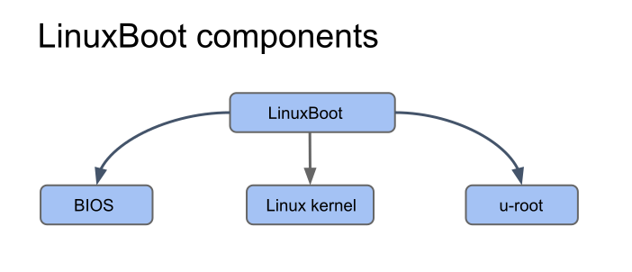

# LinuxBoot Components



LinuxBoot consists of the following components:

1. Platform initialization
2. Linux kernel
3. initramfs

## Platform initialization

Sometimes also referred to BIOS, platform initialization is the part of any
firmware that brings up DRAM and enables the platform to run a Linux kernel.
This does not have to be a specific implementation. LinuxBoot has been deployed
based on UEFI PI and [coreboot](https://coreboot.org/), for example.

## Linux kernel

LinuxBoot is not intended to be a runtime production kernel; rather, it is meant
to replace specific firmware functionality using Linux kernel capabilities and
then boot the actual production kernel on the machine. Kernel configuration
files for LinuxBoot should provide only the necessary capabilities without
bloating the size of the firmware image with unnecessary drivers and modules.

These config files disable options that are not needed in the LinuxBoot kernel
and add some patches that are needed, as opposed to generic defaults. In other
words, the kernel is supposed to be platform specific.

## Initial RAM filesystem (initramfs)

When Linux boots, it needs a root file system that provides boot and startup
utilities. In LinuxBoot, it is embedded as an initramfs within the firmware
image itself. It is intended to be placed in a flash device along with the
Linux kernel as part of the firmware image for LinuxBoot. The initramfs is
essentially a set of files and directories bundled into a single cpio archive.

The minimum structure is this:

```
/dev/console
/dev/null
/init
/proc/
/sys/
```

At boot time, the boot loader or firmware (for example, coreboot) loads the
kernel image and initramfs into memory and starts the kernel. The kernel checks
for the presence of the initramfs and, if found, unpacks it, mounts it as `/`
and runs `/init`. Should any of those steps fail, then the kernel will print a
["No working init found." error](https://docs.kernel.org/admin-guide/init.html).

From there on, you are free to design every further flow. Technically, `init`
by itself suffices, since it could create the directory structure and the
essential device nodes by itself, mount the procfs and sysfs, and set up
everything else you need. In other words, it can remain a single binary, or you
add other binaries and invoke them. It might also be a symlink, possibly to a
BusyBox-style binary.

### u-root

There are many ways to generate an initramfs. In this section we focus on
u-root, a Go user-space (a set of programs and libraries written in Go that
are used to interact with the kernel). It contains a toolset of standard
Linux applications and commands.

u-root can create an initramfs in two different modes:

* source mode, which contains:
  * Go toolchain binaries
  * A simple shell
  * Go source for tools to be compiled on the fly by the shell
* Busybox (bb) mode: This is one busybox-like binary comprising all the
    requested utilities.

The initramfs provided by u-root implements the toolchain needed to securely
boot the machine from the network, perform identity verification, communicate
with different internal boot-related components, and kexec the next kernel.

u-root is an open source project hosted on GitHub. Within the u-root
repository, we have executable commands in `cmds` and the packages containing
libraries and implementations in `pkg`.
